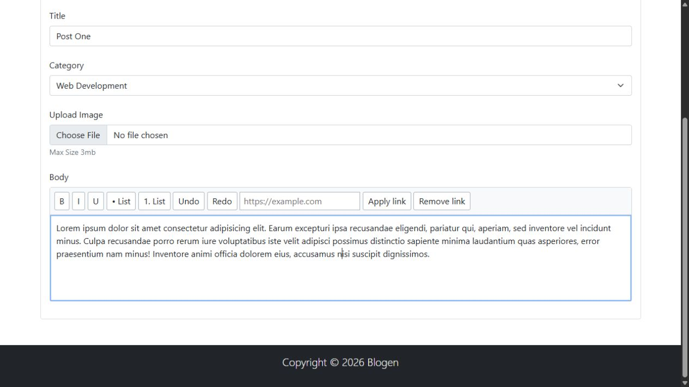

# Blogen — Administration UI

An educational Bootstrap administration-interface prototype for blog content and user management.

## Captured preview

<picture><source media="(prefers-reduced-motion: reduce)" srcset="docs/screenshots/portfolio-poster.png" /><source type="image/webp" srcset="docs/screenshots/portfolio.webp" /></picture>

Static dashboard and category modal. Wide tables use the existing scrollable region on mobile. No authentication, post creation or persistence backend.

[Reproduce this capture and view the static image](docs/PORTFOLIO-PREVIEW.md) · [Mobile capture](docs/screenshots/portfolio-mobile.png)

## Included UI

- Dashboard, posts, categories and users page layouts.
- Post details/editor, profile, settings and login presentation pages.

## Repository map

| Path | Purpose |
|---|---|
| [index.html](index.html) | Dashboard |
| [posts.html](posts.html) | Posts layout |
| [categories.html](categories.html) | Categories layout |
| [users.html](users.html) | Users layout |
| [details.html](details.html) | Post editor layout |
| [profile.html](profile.html) | Profile layout |
| [settings.html](settings.html) | Settings layout |
| [login.html](login.html) | Login presentation |
| [css](css) | Styles |
| [img](img) | Local images |

## Preview locally

Use a modern browser and Python 3 for a simple loopback-only static server. From a terminal:

```powershell
git clone https://github.com/s-hesam-s/Blogen.git
cd Blogen
```

```powershell
python -m http.server 8000 --bind 127.0.0.1
```

Open `http://127.0.0.1:8000/index.html`. Keep the terminal open while previewing and press Ctrl+C to stop it. No database or application backend is needed.

The checked-in HTML, CSS and editor bundle can be previewed directly. Node.js/npm are needed only to rebuild the local Tiptap editor; see the dependency policy below.

## External resources

The pages reference resources from `cdn.jsdelivr.net`, `code.jquery.com`, `use.fontawesome.com`. Internet access is needed for the referenced CDN scripts, fonts or remote images; the repository is not a fully offline asset bundle. Third-party resource availability can affect the preview.

## Verification and limitations

Browse dashboard and editor pages, test the layout at narrow widths and inspect form/modal controls. Login, save and account screens are static UI samples; they do not authenticate users or persist data.

An isolated Chromium regression suite checks selected real interactions at desktop and mobile widths; dependency-policy regressions run separately. Preview instructions are not a claim that every third-party widget is compatible with current CDN responses. Application services, persistent storage and deployment are outside this UI exercise.

## Project scope and reuse

This is an educational repository. The implementation notes describe the code in this repository; they do not claim a deployed commercial service or measured production results. Third-party libraries and assets retain their own terms. No project-wide license is currently declared.

## Continuous integration

GitHub Actions checks root HTML documents for a doctype, document shell, nonempty title and duplicate IDs. It also verifies local href/src/poster targets, filename casing and HTML/SVG fragments using `python3 scripts/check_site.py`. Remote URLs and placeholder `#` links are not fetched; this is not a full HTML5 conformance, accessibility or browser interaction test. The editor build also restores the locked npm dependencies, audits them and verifies the checked-in bundle. No backend or deployment is involved.

The [CI workflow](.github/workflows/ci.yml) runs for pull requests and pushes to `master`, and can be started manually. It uses read-only repository permissions and does not deploy the project.

## Runtime dependency checks

[Dependency inventory, local asset policy and verification commands](docs/FRONTEND-DEPENDENCIES.md) describe the exact runtime resources and CI guard.

## Local rich-text editor

<picture><source media="(max-width: 600px)" srcset="docs/screenshots/rich-editor-mobile.png" /></picture>

The unsupported CKEditor 4 runtime was replaced by a locally built Tiptap editor in the post, detail and profile forms. The settings page no longer initializes a nonexistent editor. Formatting, rich-text paste and allowed/blocked links were checked in the browser. These remain static sample forms without saving or submission services.

## Maintenance checks

The existing CI also runs weekly on Monday and checks tracked Markdown file destinations with `scripts/check_doc_links.py`. Its negative tests cover moved documents, missing picture variants, paths outside the repository and untracked local drafts. External URLs and heading fragments are intentionally outside this offline file check. Scheduled runs do not deploy or start original application hosts.

Browser regressions: [test scope and local commands](docs/BROWSER-TESTS.md). Exact reviewed runtime versions are also checked against current GitHub advisories; CDN coverage and API failure cases are tested separately.
